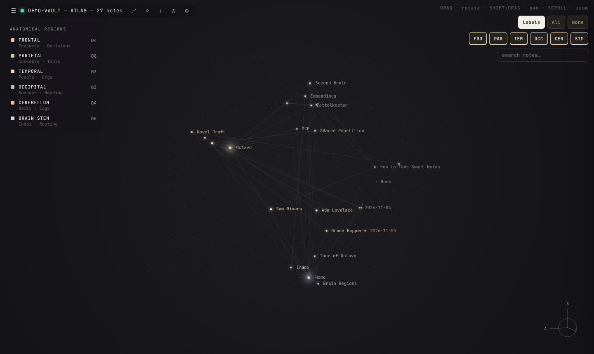
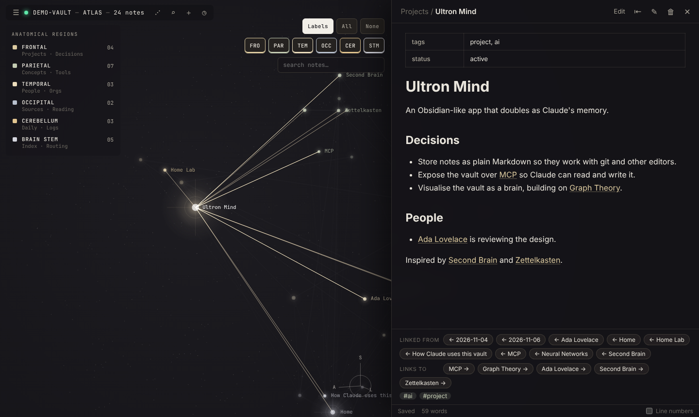
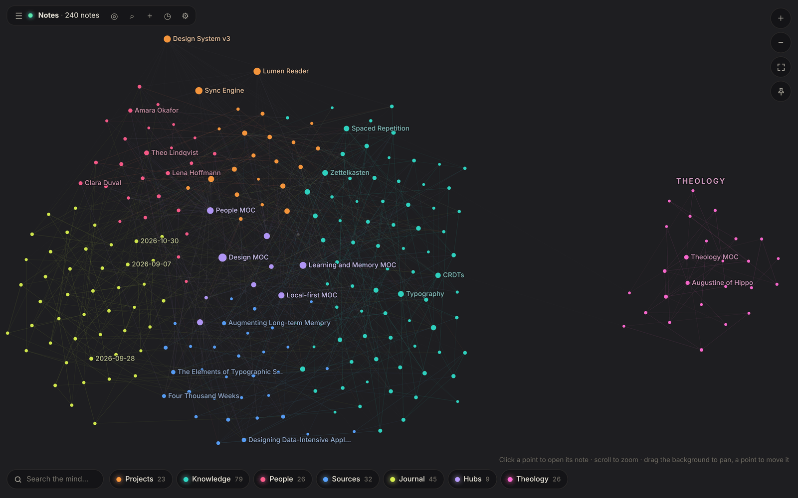
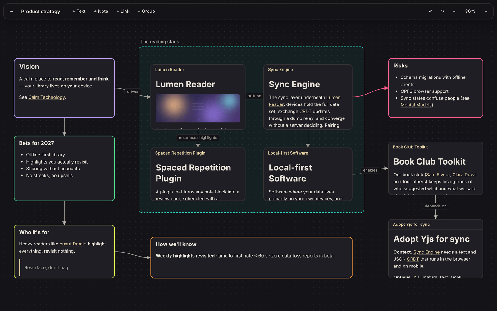
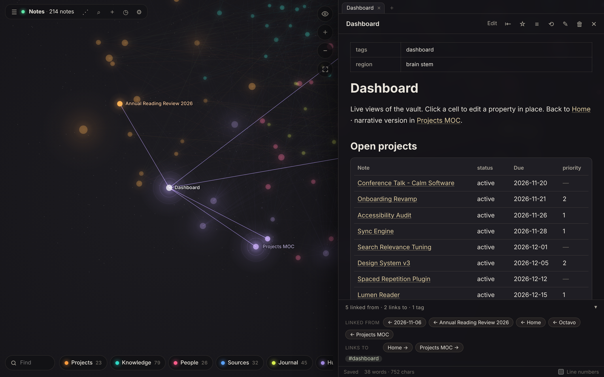
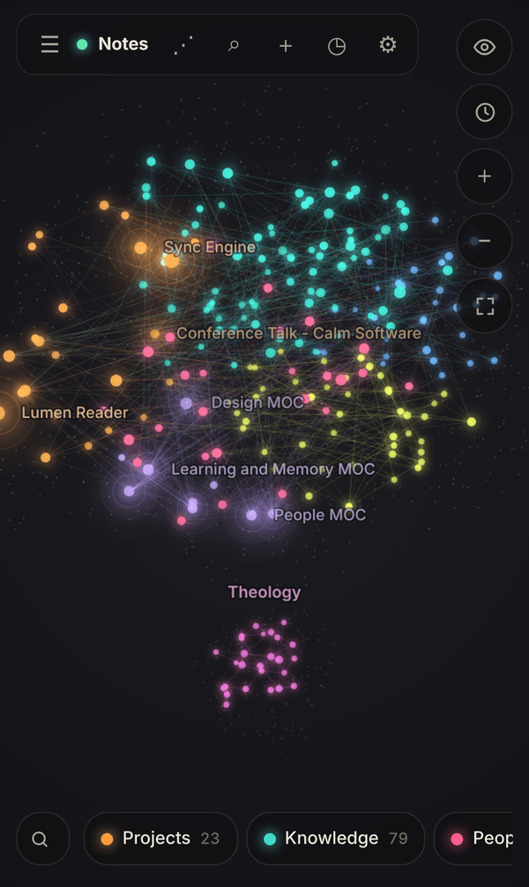

# Octavo

**A knowledge base you see as a brain, and that Claude uses as its long-term memory. Completely free: no accounts, no subscriptions, no paid tiers.**

Octavo is an Obsidian-like note app built on plain Markdown files. Your notes appear as points in a 3D brain you can turn and zoom, grouped into six coloured regions: Projects, Knowledge, People, Sources, Journal and Hubs. Click any point to read or edit that note.

It also includes an [MCP](https://modelcontextprotocol.io) server, so Claude can search, read and write the same notes. Claude remembers things between conversations, and you can watch it work: the notes it reads and changes light up live, and a fading trail shows the path it took.



<table>
  <tr>
    <td></td>
    <td></td>
  </tr>
  <tr>
    <td align="center"><sub>Click a point to open its note</sub></td>
    <td align="center"><sub>Network view</sub></td>
  </tr>
  <tr>
    <td></td>
    <td></td>
  </tr>
  <tr>
    <td align="center"><sub>Canvas boards</sub></td>
    <td align="center"><sub>Live queries (Bases / Dataview)</sub></td>
  </tr>
</table>

<p align="center"></p>

## Features

- **Brain views**
  - **Atlas**: a 3D brain with notes spread over six regions, a region dock with counts (tap to hide, double-tap to solo), find, Claude's trail, and a "bridges between regions" view, and a time-lapse of your brain growing.
  - **Network**: a flat force-directed graph, coloured by region.
- **Markdown notes**: plain `.md` files in a folder you choose. They work with git, Obsidian and any text editor.
- **Rich writing**: live preview, callouts, coloured highlights, tasks with due dates and custom marks, footnotes, LaTeX maths, Mermaid diagrams, `%%comments%%`, tables, code highlighting, and embedded images, audio, video and PDFs. Lists work like an outliner.
- **Linking**: `[[wikilinks]]` to notes, headings and blocks, `![[embeds]]`, hover previews, backlinks, unlinked mentions, aliases, nested `#tags`, and automatic link updates when you rename or move a note.
- **Queries (Bases / Dataview)**: a ` ```query ` block turns notes into a live table, list or cards (`TABLE status, due FROM "Projects" WHERE status != "done"`). Sort by clicking a column, edit a property by clicking a cell.
- **Canvas**: boards of cards and arrows in the open JSON Canvas format.
- **Drawings**: the Excalidraw editor built in, with drawings shown as pictures in your notes.
- **Organise**: tabs (also stacked), split view, pop-out windows, file tree, quick switcher, command palette, `/` slash commands, full-text search, bookmarks, templates, workspaces, and daily, weekly and monthly notes with a calendar.
- **Capture**: record audio notes, clip web pages into notes from the built-in web viewer, import from Notion and Evernote, and keep notes from Notability, GoodNotes and other apps in step through their backup folder.
- **Publish**: turn chosen notes into a free static website you can host anywhere.
- **Islands and separate brains**: keep a separate subject apart in its own corner of the brain, or keep whole separate vaults, each with its own Claude connection.
- **Optional note locking**: password-protect individual notes with end-to-end encryption. Off by default.
- **Safety net**: version history for every note, deletes go to a recoverable trash (and links to deleted notes offer to restore them), you get a conflict warning instead of losing edits, and one-click zip backups.
- **Claude memory over MCP**: 28 tools (search, read, write, append, edit, tasks, journal, queries, canvases, links, orphans…) over stdio or HTTP.
- **Phone**: open it on your phone on home Wi-Fi, or from anywhere with Access from Anywhere (your PC, your router, a free certificate; no cloud service). Installable as an app, with offline reading.
- **CLI**: `octavo tui` to browse in a terminal, plus `octavo new / read / append / search / recent / daily / task / tasks / query / set / publish / islands / theme / move / history / backup / sync-folder …`
- **Runs anywhere**: desktop app (Windows, Mac, Linux), in the browser, or self-hosted with Docker.

See **[docs/FEATURES.md](docs/FEATURES.md)** for the full feature list and what's planned.

## Download

Get the desktop app for **Windows, Mac or Linux** from the **[Releases page](https://github.com/FederalVia/Octavo/releases)**. The release notes cover the one-time security prompt for unsigned apps.

## Quick start (from source)

You need [Node.js](https://nodejs.org) 20 or newer and git.

```bash
git clone https://github.com/FederalVia/Octavo.git
cd octavo
npm install
npm run build
npm run demo          # opens the example vault at http://127.0.0.1:4321
```

Open **http://127.0.0.1:4321** in your browser and click around the brain.

To use your own notes:

```bash
npm start -- --vault ~/Octavo    # any folder; it's created if missing
```

Prefer an app window? Run `npm run desktop`.

**On your phone:** in the desktop app open **⚙ Settings → Use on your phone**. **Home Wi-Fi only** works on your own network; **Access from Anywhere** (or `npm start -- --remote`) opens your router, gets a free HTTPS certificate, and lets your phone reach your PC over mobile data and other Wi-Fi. Most routers can't reach their own internet address from inside, so turn on both and keep two home-screen icons. See **[docs/SELF_HOSTING.md](docs/SELF_HOSTING.md)**.

**Full instructions for every platform: [docs/INSTALL.md](docs/INSTALL.md)**

## Give Claude its memory

With the app built, add the vault to Claude Code:

```bash
claude mcp add octavo --scope user -- node "$(pwd)/packages/server/dist/cli.js" mcp --vault ~/Octavo
```

For Claude Desktop, remote servers and the full tool list, see **[docs/CONNECT_CLAUDE.md](docs/CONNECT_CLAUDE.md)**.

## How notes map to brain regions

Notes are placed by folder name, tag, or a `region:` value in the frontmatter:

| Region | Holds | Folders / tags like |
| --- | --- | --- |
| **Projects** (frontal) | Projects, decisions | `Projects`, `Decisions`, `Goals`, `Tasks`, `Areas` |
| **Knowledge** (parietal) | Concepts, tools (default) | `Concepts`, `Tools`, `Ideas`, `Notes`, `Wiki` |
| **People** (temporal) | People, organisations | `People`, `Contacts`, `Orgs`, `Companies`, `Teams` |
| **Sources** (occipital) | Sources, reading | `Sources`, `Repos`, `Reading`, `Books`, `Articles`, `Resources` |
| **Journal** (cerebellum) | Daily notes, logs | `Journal`, `Daily`, `Logs`, `Meetings`, `Incidents`, date-named notes |
| **Hubs** (brain stem) | Index, routing | top-level `Home` / `Index` / `README`, `Inbox`, `MOCs` |

Numbered folders such as `00 - Current Projects` work too. More in the [user guide](docs/USER_GUIDE.md#brain-regions).

## Documentation

| Guide | What's in it |
| --- | --- |
| [Installation](docs/INSTALL.md) | Requirements, installing on macOS/Windows/Linux, desktop app, Docker, running as a service, HTTPS, updating, troubleshooting |
| [User guide](docs/USER_GUIDE.md) | The interface, views, writing syntax, links, search, templates, bookmarks, history, shortcuts |
| [Features](docs/FEATURES.md) | Every feature with its status: done, partly done, or planned |
| [Use from anywhere](docs/SELF_HOSTING.md) | Reach Octavo on your PC from your phone anywhere: Access from Anywhere, troubleshooting, Docker |
| [Connecting Claude](docs/CONNECT_CLAUDE.md) | Claude Code, Claude Desktop, remote access, tool reference, tips |
| [Architecture](docs/ARCHITECTURE.md) | How it's built, REST API, live events, file handling, security |
| [Contributing](CONTRIBUTING.md) | Development setup, tests, project layout |

## Project layout

```
packages/
  core/      Vault engine: parsing, link index, backlinks, search, rename, file watching
  server/    REST API, web hosting, MCP server (HTTP + stdio), `octavo` CLI
  web/       React + CodeMirror front end (atlas, network, editor, canvas, drawings)
  desktop/   Electron wrapper
examples/
  demo-vault/  Sample notes for trying the app
docs/          Guides and screenshots
```

## Status

Octavo 1.0 is out. It's used daily and has tests; the [feature list](docs/FEATURES.md) shows what's done and what's planned next (plugins, and encrypted sync between devices without your PC). The app isn't signed with a paid developer certificate, so Windows and macOS show a one-time warning on first launch; the release notes explain the click-through.

## License

Octavo is free software, licensed under the [GNU Affero General Public License v3.0 or later](LICENSE) (AGPL-3.0-or-later). You can use, study, change and share it. If you distribute a modified version, or run one as a service other people use over a network, you must make your source code available under the same license.
