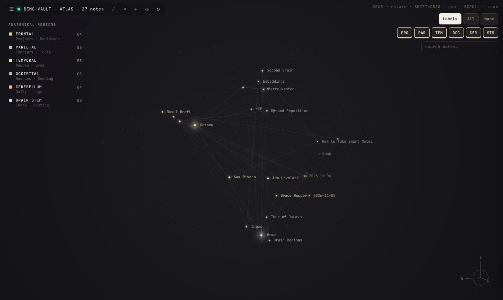
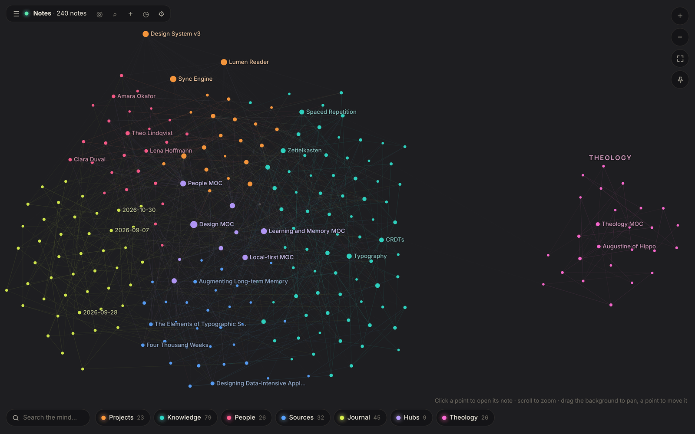
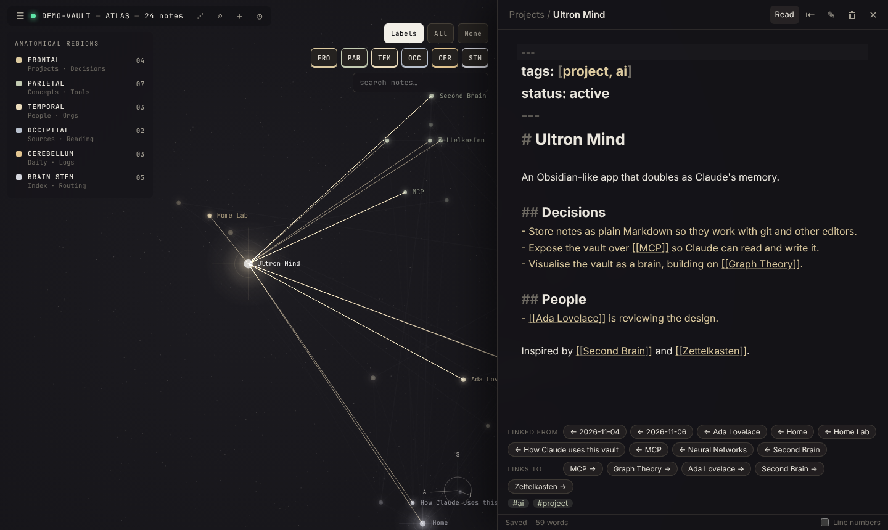

# User guide

- [The screen](#the-screen)
- [Atlas view](#atlas-view)
- [Islands](#islands)
- [Network view](#network-view)
- [Brain regions](#brain-regions)
- [Reading and editing notes](#reading-and-editing-notes)
- [Writing syntax](#writing-syntax)
- [Images and attachments](#images-and-attachments)
- [Links, tags and properties](#links-tags-and-properties)
- [Finding things](#finding-things)
- [Organising notes](#organising-notes)
- [Command palette and slash commands](#command-palette-and-slash-commands)
- [Templates](#templates)
- [Bookmarks](#bookmarks)
- [Tasks](#tasks)
- [Insights: orphans, dead ends, unlinked mentions](#insights-orphans-dead-ends-unlinked-mentions)
- [Version history](#version-history)
- [Locked (encrypted) notes](#locked-encrypted-notes)
- [Queries (Bases)](#queries-bases)
- [Canvas](#canvas)
- [Drawings](#drawings)
- [Audio notes](#audio-notes)
- [Web viewer and clipping](#web-viewer-and-clipping)
- [Publishing a website](#publishing-a-website)
- [Daily journal](#daily-journal)
- [When Claude (or anything else) edits a note](#when-claude-or-anything-else-edits-a-note)
- [Keyboard shortcuts](#keyboard-shortcuts)
- [Using it alongside Obsidian, git and other editors](#using-it-alongside-obsidian-git-and-other-editors)

---

## The screen



- **The brain** fills the window. Every note is a point, and every link between notes is a line.
- **The toolbar** (top left) has these buttons, from left to right:
  - ⚙ opens settings: note locking, Vim, line numbers, and the default brain view.
  - ☰ opens the drawer. Its tabs are Files ▤, Search ⌕, Tags #, Tasks ☑, Bookmarks ☆ and Insights ◇.
  - The green dot shows live sync is connected.
  - The title shows the vault name, the current view and the note count.
  - ⋰ / ◎ switches between the atlas and network views.
  - ⌕ opens the quick switcher.
  - ＋ creates a new note.
  - ◷ opens today's journal.
- **The note panel** slides in from the right when you open a note. Close it with **Esc**, the ✕ button, or by clicking empty space in the brain.

## Atlas view

A 3D brain. Notes are grouped into [regions](#brain-regions).

| Action | How |
| --- | --- |
| Turn the brain | Drag |
| Move it | Shift + drag or right-drag; on a phone, two fingers |
| Zoom | Scroll, pinch, or the ＋ / − buttons |
| Show the whole brain again | ⛶ button |
| Open a note | Click (or tap) its point |
| Highlight a note's connections | Hover over it |

- **Region dock** (bottom): one pill per region (Projects, Knowledge, People, Sources, Journal, Hubs) with its note count. Tap a pill to hide or show that region; double-tap to show only that one. **Find** highlights notes whose names match; press Enter to fly to the first.
- **View menu** (the eye button, top right): note names on or off, and **Claude's trail**, a fading line through the notes Claude read or changed in the last 30 minutes, so you can see the shape of a whole session after the glow has gone. The trail survives a reload. It also shows reads by Claude Desktop, which runs its own copy of Octavo. **Bridges between regions** dims the links inside each region and brightens the ones between regions. Links from notes tagged `#surprise` (or with `surprise: true` in their properties) are always drawn as bright dashed lines.

## Islands

An island keeps a separate subject apart. If your vault is mostly about one thing but has a folder about something unrelated (say, a `Theology` folder among software notes), make that folder an island: its notes get their own area and colour, set apart from the six regions, instead of being mixed into Knowledge.

- **Make one:** right-click the folder in the file tree → **Keep apart as an island**, or ⚙ Settings → **Islands** → choose a folder → **Add**. Subfolders come along.
- **In the brain** the island floats as its own small cluster beside the brain. **In the network view** it gets its own area beside the main map, with its name above it.
- Each island has a pill in the dock with its note count. Tap it to hide or show the island, like a region.
- Links between an island and the rest are still there, drawn faint.
- A single note somewhere else can join an island with `region: Theology` (the island's name) in its properties.
- Rename an island or change its colour in Settings. **Remove** puts its notes back in the regions; nothing is moved or changed in your files.
- Claude can list, add and remove islands too (`manage_islands`), and so can the terminal: `octavo islands`, `octavo islands add Theology`, `octavo islands remove Theology`. Islands are saved in the vault (`.octavo/islands.json`), so every device sees them.

## Network view



A flat map of your notes. Each region gets its own area (Projects, Knowledge, People, Sources and Journal around the edge, Hubs in the middle), in the same colours as the brain, and only the most important names are labelled until you zoom in. Scroll or pinch to zoom (between your fingers on a phone), drag the background or use one finger to pan, and drag points with a mouse to move them. Hover a point to see its connections; click or tap it to open the note. The dock at the bottom works like the brain's: **Search the mind…** highlights matching notes (Enter opens the best match), and the region pills hide or show a region. The layout settles in a few seconds and then stops moving, so it costs nothing while you read.

## Brain regions

Each note belongs to one region. The rules are checked in this order:

1. A `region:` value in the note's frontmatter, e.g. `region: temporal`. You can use the full name (`frontal`, `brain stem`) or the short code (`FRO`, `STM`).
2. Top-level notes named `Home`, `Index`, `README` or `Start here` go to the **brain stem**.
3. The **folder names** in the note's path.
4. The note's **tags**.
5. Notes named with a date (`2026-11-06…`) go to the **cerebellum**.
6. Anything else goes to the **parietal** lobe.

In the app each region is shown by an everyday name: **Projects** (frontal), **Knowledge** (parietal), **People** (temporal), **Sources** (occipital), **Journal** (cerebellum) and **Hubs** (brain stem).

| Region | Holds | Folder or tag names that match |
| --- | --- | --- |
| Frontal | Projects, decisions | projects, current projects, decisions, goals, plans, planning, tasks, todos, okrs, roadmaps, areas |
| Parietal | Concepts, tools | concepts, tools, ideas, knowledge, topics, notes, zettels, zettelkasten, permanent, wiki, tech, skills, evergreen |
| Temporal | People, organisations | people, persons, contacts, orgs, organisations, companies, teams, family, friends, clients, customers, crm |
| Occipital | Sources, reading | sources, repos, repositories, reading, books, articles, papers, references, resources, links, bookmarks, media, videos, podcasts, courses, literature, clippings |
| Cerebellum | Daily notes, logs | journal(s), daily, dailies, daily notes, logs, incidents, meetings, standups, diary, calendar, archive(s), periodic |
| Brain stem | Index, routing | home, index, readme, start here, mocs, maps of content, hubs, dashboards, inbox, unsorted, routing |

Matching ignores case and leading numbers, so `00 - Current Projects` counts as "current projects".

## Reading and editing notes

Click a point, or pick a note from the drawer or the quick switcher, to open it in the note panel.



- **Read / Edit** (or **Ctrl/Cmd+E**) switches between the rendered note and the Markdown editor.
- **Changes save automatically** shortly after you stop typing. The status bar shows *Editing… → Saving… → Saved*. **Ctrl/Cmd+S** saves immediately.
- **⇤ / ⇥** makes the panel wider or narrower.
- **☆ / ★** bookmarks the note.
- **≡** shows the outline (headings). Click one to jump to it.
- **⟲** opens the [version history](#version-history).
- **✎** renames or moves the note. You can also double-click the title.
- **🗑** deletes the note. It goes to the vault's `.trash` folder, so you can recover it. If you later click a link to a deleted note, Octavo offers to restore it with its old content instead of creating a blank one.
- **Under the note**:
  - *Linked from* shows notes that link here (backlinks).
  - *Links to* shows notes this one links to.
  - *Mentioned in* shows notes that use this note's name without linking to it.

  Click any of them to jump there. The brain flies to the new note.
- **Hover over a link** in reading view to preview the linked note.
- **Click a task checkbox** in reading view to tick it. The note is updated and saved.
- The status bar shows word and character counts.

**Editor features:**
- Type `[[` to get note-name suggestions, `#` for tag suggestions, and `/` for [slash commands](#command-palette-and-slash-commands).
- Paste or drag images and other files in to [upload them](#images-and-attachments).
- Vim keybindings: command palette → *Turn on Vim keybindings*.
- **Ctrl/Cmd+click** a `[[link]]` to follow it.
- Code blocks are highlighted for most languages.
- Standard editing keys work, including undo/redo and Ctrl/Cmd+F to find in the note.

## Writing syntax

Octavo reads standard Markdown plus these extras. The demo vault's **Formatting Showcase** note shows all of them.

| Write | Get |
| --- | --- |
| `**bold**`, `*italic*`, `~~strike~~`, `` `code` `` | Basic formatting |
| `==highlight==`, `=={green}highlight==` | Highlights in yellow (default), red, orange, green, blue or purple |
| `- [ ] task`, `- [x] done` | Task checkboxes. Any single character works as a status: `[-]` cancelled, `[?]` question, `[!]` important… |
| `> [!note] Title` | A callout. Types: note, info, tip, success, question, warning, failure, danger, bug, example, quote, abstract, todo |
| `> [!tip]- Title` / `> [!tip]+ Title` | A foldable callout, closed / open by default |
| `Text.[^1]` … `[^1]: The footnote` | Footnotes |
| `$E = mc^2$`, `$$ … $$` | Inline and block maths (LaTeX) |
| ```` ```mermaid ```` code block | Diagrams: flowcharts, sequence diagrams, timelines, … A box whose label is a note's name opens that note |
| `%%hidden%%` | A comment, visible only in the editor |
| `Some paragraph ^my-id` | A block id, so `[[Note#^my-id]]` can link to or embed exactly that paragraph |
| ```` ```js ```` code block | Code, highlighted in the editor and in reading view |
| ```` ```tasks ```` code block | A live list of tasks from the whole vault (see [Tasks](#tasks)) |
| ```` ```query ```` code block | A live table, list or cards of notes (see [Queries](#queries-bases)) |
| `\| a \| b \|` tables | Tables (`/table` inserts one). In reading view, right-click a cell (or tap it, then ⋯) to sort, insert, move, align or delete rows and columns |

## Images and attachments

- **Paste** an image (e.g. a screenshot) or **drag files** into the editor. They're saved to the vault's `attachments/` folder, and an embed such as `![[screenshot.png]]` is inserted.
- **Embed** files with `![[file.png]]`. Images, audio (`mp3`, `wav`, `m4a`, `ogg`…), video (`mp4`, `mov`, `webm`…) and PDFs all display inline. The name alone is enough: the file can be in any folder.
- **Resize** an image with `![[photo.png|300]]` (width) or `![[photo.png|300x200]]`.
- Standard Markdown images work too: ``.

## Links, tags and properties

| Syntax | Meaning |
| --- | --- |
| `[[Note name]]` | Link to a note by name |
| `[[Folder/Note name]]` | Link by path (when two notes share a name) |
| `[[Note name\|shown text]]` | Link with different display text |
| `[[Note name#Heading]]` | Link to a section |
| `[[Note name#^block-id]]` | Link to a specific block |
| `![[Note name]]` | Embed the whole note inline |
| `![[Note name#Heading]]` / `![[Note name#^block-id]]` | Embed just a section or a block |
| `[text](Other%20Note.md)` | Ordinary Markdown link to another note |
| `#tag`, `#nested/tag` | Tags. They also count as the parent tag (`#nested`). |

- **Links to notes that don't exist yet** are shown faded. Click one to create the note.
- **Renaming or moving a note updates every link** that points to it, in all notes.
- **Frontmatter** (YAML between `---` lines at the top of a note) is shown as a properties table. Hover it and click **Edit** (or command palette → *Edit properties*) to edit it with typed fields: text, list, number, checkbox and date. Special keys:
  - `tags: [a, b]` adds tags.
  - `aliases: [Other Name]` lets `[[Other Name]]` link to this note.
  - `region: frontal` places the note in a brain region.

## Finding things

- **Quick switcher** (**Ctrl/Cmd+O**): type part of a note's name and press Enter to open it. **Shift+Enter** (or the *Create* entry) makes a new note with that name.
- **Search** (**Ctrl/Cmd+Shift+F**, or ☰ → Search) searches the full text:
  - `deploy staging`: notes containing both words
  - `"exact phrase"`
  - `tag:project` or `#project`: notes with that tag
  - `path:Projects`: notes in a folder
  - Combinations work too, e.g. `tag:person path:Work alice`.

  Clicking a result opens the note. Clicking a matching line jumps to that line in the editor.
- **Tags** (☰ → Tags): every tag and how many notes use it. Click one to search for it.
- In either brain view, the **search box** highlights matching points.

## Organising notes

- **New note**: ＋ in the toolbar or **Ctrl/Cmd+N**. Type `Folder/Name` to put it in a folder, which is created automatically. In the file tree, right-click a folder and choose **New note here**.
- **Move**: drag a note onto a folder in the file tree, or rename it to a new path, e.g. `Archive/Old idea`.
- **Rename / delete**: right-click a note in the file tree, or use the buttons in the note panel.
- **Folders** exist as long as they contain notes.
- **Split / merge**: select text in the editor and use *Extract selection to new note*, or use *Merge this note into another…* to combine duplicates. Its text is added to the end of the other note, links are updated, and it goes to the trash.
- **Import** (desktop): **File → Import** brings in an unzipped Notion export (Markdown & CSV) or an Evernote `.enex` file, into an `Imported/` folder. From a terminal: `octavo import notion <folder>` or `octavo import evernote <file.enex>`.
- **Links from other apps** (desktop): command palette → *Copy octavo:// link*. Opening `octavo://open?vault=<brain>&file=<note>` anywhere (a browser, another app, a chat) opens that note in Octavo.

## Command palette and slash commands

**Ctrl/Cmd+P** opens the command palette. Type to find any action, then press Enter:

- **Create:** new note, new unique note (timestamp name), new note from template
- **Navigate:** today's journal, quick switcher, random note, search, tasks, bookmarks, insights
- **Current note:** insert template, bookmark, version history, extract selection to a new note, copy link, rename, delete
- **Settings:** switch view, Vim keybindings, line numbers

**Slash commands**: type `/` at the start of a word in the editor for a menu of things to insert:

- headings, task, bullet and numbered lists, quote
- callouts (note, tip, warning, foldable)
- table, code block, maths, Mermaid diagram, divider
- highlight, comment, footnote, link, embed
- today's date or the current time
- a template

## Templates

Put notes in a **`Templates/`** folder. When a template is used, these placeholders are filled in:

| Placeholder | Becomes |
| --- | --- |
| `{{title}}` | The note's name |
| `{{folder}}` | The note's folder |
| `{{date}}` | Today, as `2026-11-06` |
| `{{time}}` | Now, as `14:05` |
| `{{date:dddd, D MMMM YYYY}}` | A custom format: `YYYY`, `MMMM` (November), `MMM` (Nov), `MM`, `M`, `dddd` (Friday), `ddd` (Fri), `DD`, `D`, `HH`, `mm`, `ss` |
| `{{date+7d}}`, `{{date-1w:DD/MM}}` | A date before or after today: `d` days, `w` weeks, `m` months, `y` years |
| `{{yesterday}}`, `{{tomorrow}}` | Those dates |
| `{{weekday}}`, `{{week}}`, `{{month}}`, `{{year}}` | Friday, 45, November, 2026 |

Templates never run code. Claude and other tools can write notes, so a template that ran scripts would be a security risk.

- **Insert a template** into the current note: `/template` in the editor, or command palette → *Insert template…*. A template's frontmatter is left out when inserting.
- **Create a note from a template**: command palette → *New note from template…*

The demo vault includes `Templates/Meeting` and `Templates/Book`.

## Bookmarks

The **☆** button on a note bookmarks it. To bookmark a heading, hover it in reading view and click the ☆ next to it. **☆ Bookmark this search** in the Search tab saves a search. In the Bookmarks tab (☆) you can also add web links. Bookmarks are stored in the vault at `.octavo/bookmarks.json`, so they move with the vault.

## Tasks

The **Tasks** tab (☑) lists every open task in the vault, **by note** or **by date** (Overdue, Today, Next 7 days, Later, No date). Tick tasks right there, or click a task to jump to it. *Show completed* includes finished ones. From a terminal: `octavo tasks` and `octavo task "something"`. Claude can list and update tasks too, for example "what's overdue?".

**Due dates:** add `📅 2026-11-10` to a task, or type `/due` in the editor and pick *Due today*, *Due tomorrow* or *Due in a week*. `due: 2026-11-10` and `[due:: 2026-11-10]` work too. Overdue dates are shown in red.

**Task lists anywhere:** a ` ```tasks ` code block shows matching tasks from the whole vault, and you can tick them right there. One rule per line:

````
```tasks
not done
due before in 7 days
tag includes #work
sort by due
```
````

| Rule | Example |
| --- | --- |
| `not done` / `done` | Open or finished tasks |
| `due before …` / `due after …` / `due on …` | A date: `2026-12-01`, `today`, `tomorrow`, `yesterday`, `in 3 days`, `2 weeks ago`, `next week` |
| `has due date` / `no due date` | |
| `path includes …` / `text includes …` / `tag includes #…` | Also `does not include` |
| `sort by due` / `sort by path` | |
| `group by note` / `group by due` | |
| `limit 10` | |

## Insights: orphans, dead ends, unlinked mentions

The **Insights** tab (◇) helps keep the vault connected:

- **Orphans**: notes that no other note links to.
- **Dead ends**: notes that don't link anywhere.
- **Not written yet**: link targets that don't exist. Click one to create it.

Under each note, **Mentioned in** lists notes that use its name in plain text without linking. These are good candidates for new links.

## Version history

Before a note changes, Octavo keeps a copy of the previous version (at most every 5 minutes, newest 50 per note) in the vault's `.octavo/history/` folder. Click **⟲** on a note to see its versions. Each one shows what changed compared with the current note, and **Restore this version** brings it back. The current content is saved first, so a restore can be undone too. This covers edits by Claude as well.

## Locked (encrypted) notes

You can lock any note with a password: diary entries, health records, anything private. This is **optional and off by default**. Turn it on in **⚙ Settings → Lock notes with a password**, and a 🔐 button appears on each note. The setting is stored in the vault, so it applies on every device. Notes that are already locked still open, with a password prompt, even if the setting is off.

- **Lock**: open the note and click **🔐** (or command palette → *Lock note with a password*). Enter a password of at least 8 characters, twice.
- **Read and edit**: a locked note shows a 🔒 screen. Enter the password to unlock it, then read and edit as usual. Every save is encrypted before it leaves your browser.
- **Lock again**: click **🔓**, or command palette → *Lock all unlocked notes*. Notes also lock when you reload or close the tab, and after 15 minutes without activity.
- **Change the password** or **remove encryption**: unlock the note, then use the command palette.

**How it works.** The note is encrypted in your browser with AES-256-GCM, using a key derived from your password (PBKDF2-SHA256, 600,000 iterations, a random salt per note). The server, Claude, search and anyone who copies your files only ever see scrambled data. Your password is never sent anywhere.

**Good to know:**

- **There is no password recovery.** If you forget a note's password, its contents are gone for good. Consider keeping it in a password manager.
- **The note's title (file name), folder and links *to* it stay visible.** Choose a neutral title if the title itself is sensitive.
- **Locked notes are left out** of search, tasks, tags, mentions and the brain's link lines from that note. They appear in the brain with a 🔒.
- **Claude can see that a locked note exists, but can't read, change or delete it.**
- **Locking deletes the note's earlier plain-text versions from Octavo's version history.** Copies elsewhere, such as git history, backups or sync services, may still hold the old plain text.
- **The file is still a `.md` file** with a short "this note is locked" message, so Obsidian and git show a placeholder. Don't edit that file by hand, or it can no longer be unlocked.
- On your phone over home Wi-Fi (`http://`), the same encryption runs in JavaScript. Unlocking takes a moment longer but is just as secure, and the password never leaves the phone.

## Queries (Bases)

A ` ```query ` code block turns notes into a live table, list or cards, like a small database. It updates as notes change.

````markdown
```query
TABLE status, due AS "Due" FROM "Projects" WHERE status != "done" SORT due ASC
```
````

- **TABLE**, **LIST** or **CARDS**, then the columns (`AS "Label"` renames one; `TABLE WITHOUT ID` hides the note name).
- **FROM** picks notes: `"Folder"` (subfolders included), `#tag`, `[[Note]]` (notes that link to it; `[[]]` is this note). Combine with `and`, `or`, `not`.
- **WHERE** filters: `status = "active"`, `priority >= 2`, `due < date(today)`, `contains(file.tags, "idea")`, `!reviewed`. Join with `and` / `or`.
- **SORT** `field ASC|DESC`, **GROUP BY** `field`, **LIMIT** `n`.
- **Fields** are a note's properties and inline `key:: value` lines, plus `file.name`, `file.folder`, `file.path`, `file.tags`, `file.mtime` (modified), `file.ctime` (created), `file.size`, `file.links` and `file.inlinks` (link counts). `this.field` reads the note the query is in.
- **Functions:** `contains`, `startswith`, `endswith`, `length`, `lower`, `upper`, `default(a, b)`, `number`, `round`, `date(today)` (also `yesterday`, `tomorrow`, `now`, a date), `dur(7 days)`, `days(due)` (days from today, negative when past).

Click a column header to sort (click again to reverse, a third time to go back to the query's order). **Click a cell** in a property column to edit that property; press Enter to save or Esc to cancel. Lists are edited as `a, b, c`.

` ```dataview ` blocks work the same way, so most Dataview `TABLE` and `LIST` queries from Obsidian work as they are. A ` ```base ` block takes the same settings as YAML:

````markdown
```base
from: '#person'
where: role
columns: [role, file.mtime AS "Updated"]
sort: file.mtime desc
view: cards
```
````

From a terminal: `octavo query 'LIST FROM #project WHERE due < date(today)'` and `octavo set "Octavo" status done`. Claude can use the same queries with `query_notes`, and set properties with `set_property`.

## Canvas

A canvas is an endless board for laying out ideas: cards you can move around, connected by arrows. Command palette → **New canvas…** (or **Open canvas…**). Canvases appear in the file tree with ◫, and `[[Board.canvas]]` links open them.

- **Cards:** double-click empty space to write a text card (Markdown and `[[links]]` work). **+ Note** adds a live view of a note; click its title to open it. **+ Link** adds a web link. Paste or drop an image or file to add it, and drag notes from the file tree onto the board.
- **Arrows:** select a card and drag one of the dots on its edges onto another card. Drop it on empty space instead and a new card grows there, already connected. Double-click an arrow to label it.
- **Arranging:** drag cards to move them (they snap to the grid), drag the corner to resize, and Shift-drag on empty space to select several. **+ Group** puts the selected cards in a labelled group (double-click the label to rename it); moving a group moves everything in it.
- **Colours:** with something selected, pick one of six colours.
- **Moving around:** drag empty space (or one finger) to pan. Ctrl/Cmd + scroll or pinch zooms. The % button fits everything on screen.
- **Keys:** Delete removes the selection, Ctrl/Cmd+Z undoes, Ctrl/Cmd+Shift+Z redoes, Ctrl/Cmd+A selects everything, Enter edits the selected text card, and Esc deselects or closes the canvas.

Canvases are saved as `.canvas` files in the open [JSON Canvas](https://jsoncanvas.org) format, so other apps that support it can open them. Claude can read them and add cards and arrows too.

## Drawings

Sketch diagrams, mind maps and doodles with the built-in [Excalidraw](https://excalidraw.com) editor. Command palette → **New drawing…** With a note open, the drawing is also embedded in it, so it shows up as a picture right where you are.

- Draw with the toolbar at the top (or its number keys): shapes, arrows, lines, free-hand pen, text and images. Everything keeps its hand-drawn look.
- It saves as you go. **Done** (or ← Back to notes in the ☰ menu) takes you back.
- `![[Name.excalidraw]]` in any note shows the drawing as a picture, matching your light or dark theme. Click it to edit. `[[Name.excalidraw]]` is a plain link to it.
- **Open drawing…** finds existing drawings, and they appear in the file tree with ✎.
- The ☰ menu can export a drawing as PNG or SVG.

Drawings are `.excalidraw` files in Excalidraw's own format, so excalidraw.com and other apps can open them too. The drawing tools download the first time you open a drawing; after that, and in the desktop app, they work offline.

## Audio notes

Command palette → **Record audio note**. A small recorder appears at the bottom with a timer and a level meter; **Pause** and **Stop & save** do what they say, ✕ throws the recording away. The file is saved in `attachments/` and embedded where you are: at the cursor when editing, at the end of the note when reading, or as a timestamped line in today's journal when no note is open. Recordings play right in the note.

Browsers only allow the microphone on a secure connection, so recording works in the desktop app and on the computer running Octavo. On a phone, use an `https://` address (Tailscale or access from anywhere).

## Web viewer and clipping

Read web pages without leaving Octavo: **Alt/Option-click** a link in a note, or command palette → **Open web page…** To open every web link this way, run **Open web links in Octavo’s web viewer** (run it again to switch back). Cmd/Ctrl-click always opens your browser.

- **Reader** (the default) shows just the article: no ads, menus or pop-ups. Octavo fetches the page itself, so it works everywhere.
- **Live** shows the real page. In the desktop app almost every site works. In a browser, some sites refuse to be shown inside other pages; use ↗ to open those in a new tab.
- **Save to vault** turns the article into a note in `Clippings/`, with its address, the date and the author in its properties.

For safety the viewer only opens public web addresses, never ones on your own network.

## Publishing a website

Turn some of your notes into a plain website you can host for free anywhere. There's no account or paid service.

1. Mark the notes to share: open a note and run **Publish this note** from the command palette (it adds `publish: true` to its properties). Or skip this and publish a whole folder or tag.
2. Command palette → **Publish as a website…** Choose what to include and a title, then **Download site (.zip)**.
3. Unzip it and upload the folder to a static host: GitHub Pages, Netlify (drag the folder onto app.netlify.com/drop), Cloudflare Pages, or your own server.

What you get: one page per note with working links, embeds, images, callouts, tasks, math and diagrams. Each page lists the published notes linking to it, every tag gets a page, and there's a search box. Pages follow the visitor's light or dark setting. The vault's home note becomes the front page if you publish it.

What stays private: notes you don't publish, notes marked `publish: false`, locked notes and templates. A link to a note that isn't published shows as plain text, so its name appears but it can't be opened. Query blocks are saved as tables of published notes only.

From a terminal: `octavo publish ./site` (notes marked `publish: true`), or add `--folder Projects`, `--tag garden` or `--all`, plus `--title "My notes"`. Math and diagrams load their display code from a CDN when a page uses them.

## Daily journal

**Ctrl/Cmd+D** (or ◷) opens today's note, `Journal/YYYY-MM-DD.md`, and creates it if needed. Claude adds timestamped entries here when it uses `log_to_journal`. To use a different folder, start the server with `--daily <folder>`. If you keep an index note named after the folder (`Journal.md`), each new daily note is added to it as a link.

**Weekly and monthly notes:** command palette → *Open this week's note* (`Journal/Weekly/2026-W45.md`, with links to each day) or *Open this month's note* (`Journal/Monthly/2026-11.md`). From a terminal: `octavo weekly`, `octavo monthly`. Claude can open them with `open_periodic_note`, e.g. to plan the week.

## When Claude (or anything else) edits a note

- The note's point **lights up**, and signals travel along its links.
- **New notes grow into the brain** where they belong.
- If the note is open and you **haven't changed it**, it reloads automatically.
- If you **were editing it**, a yellow banner appears instead of anything being overwritten. Choose **Load theirs** to take the other version, or **Keep mine** to save yours over it.

## Keyboard shortcuts

On macOS, use **Cmd** instead of **Ctrl**.

| Shortcut | Action |
| --- | --- |
| Ctrl+P | Command palette |
| Ctrl+O | Quick switcher |
| Ctrl+N | New note |
| Ctrl+D | Today's journal note |
| Ctrl+E | Toggle read / edit |
| Ctrl+S | Save now |
| Ctrl+Shift+F | Search |
| Ctrl+\ | Toggle the drawer |
| Ctrl+G or Esc | Close the note and return to the brain |
| Ctrl+click on `[[link]]` | Follow the link (in the editor) |
| Shift+Enter | Create the typed note (in the quick switcher) |
| `/` | Slash commands (in the editor) |

## Brains (separate vaults)

A brain is a separate vault: its own folder, notes, graph and settings. Use them to keep work, school or one project apart from everything else, including what Claude can see.

- **Create one:** Settings → Brains → New brain, or File → Brains → New Brain…. It's created in `~/Octavo Brains/<name>`.
- **Use an existing folder:** File → Brains → Add Existing Folder as Brain….
- **Switch:** File → Brains, or Settings → Brains → Open.
- **Remove:** Settings → Brains → Remove. This only takes it off the list; the notes stay in their folder.
- **Claude:** each brain is a separate connection (`octavo`, `octavo-work`, …). See [Separate brains](CONNECT_CLAUDE.md#separate-brains).

## Tabs, split view and windows

- **Tabs:** opening a note replaces the current tab. **Ctrl/Cmd+click** or **middle-click** a link (or a note in the file tree) opens it in a new tab, and **＋** in the tab bar opens any note in one. Middle-click a tab to close it. In the desktop app, **Ctrl+T**, **Ctrl+W** and **Ctrl+Tab** work like a browser. Open tabs are remembered.
- **Split view:** command palette → *Show another note alongside*, right-click a tab, or right-click a note in the file tree → *Show alongside*. The second note is shown in reading view; **⇄** swaps it into the main pane to edit it.
- **New window:** command palette → *Open this note in a new window*.
- **Workspaces:** command palette → *Save workspace* stores the open tabs, split view, sidebar and brain view under a name; *Open workspace* brings it back.


**Stacked tabs:** command palette → *Stack tabs*. The open note stays full size and the other tabs fold into narrow spines with their titles running up the side: earlier tabs on the left, later ones on the right. Click a spine to open it, or × to close it. *Show tabs in a row* switches back.

## Editing with live preview

While you edit, Markdown is shown formatted: `**bold**` looks bold, `[[links]]` look like links, and `- [ ]` is a real checkbox. The symbols reappear on the line your cursor is on, so you can change them. Click a link to open it. To always see the raw Markdown, turn off **Settings → Editor → Live preview** (or command palette → *Show raw Markdown while editing*).


### Outlining

Lists work like an outliner while you edit:

| Keys | What it does |
| --- | --- |
| Tab / Shift-Tab | Indent or outdent the list item, taking everything nested under it along |
| Ctrl/Cmd + Shift + ↑ / ↓ | Move the item (and its children) above the previous or below the next item at the same level |
| Ctrl/Cmd + Enter | Turn the line into a task, then tick and untick it |
| Ctrl/Cmd + Shift + [ / ] | Fold or unfold the item or section at the cursor (or use the ▾ arrows in the margin) |

## Calendar

The **Calendar** tab (▦) in the sidebar shows a month. Days with a journal note are highlighted, and a dot means a task is due that day (red if it's overdue). Click a day to open or create its note, a week number for that week's note, or the month name for the month's note.

## Slides, PDF and printing

- **Slides:** command palette → *Start presentation*. Each part of the note between `---` lines is a slide. Use the arrow keys, space, or click (left third goes back). Esc leaves.
- **PDF:** command palette → *Export to PDF*. The desktop app asks where to save the PDF. In a browser or on your phone, the print dialog opens: choose *Save as PDF* (on iPhone: Share → Print, then pinch out on the preview to get a PDF).

## Appearance and hotkeys

- **Settings → Appearance:** dark, light or match system, and an accent colour. These are saved on each device. The brain view always stays dark.
- **CSS snippets:** put `.css` files in the brain's `.octavo/snippets` folder, then switch them on in **Settings → Appearance**. They apply to the whole app and are saved with the brain.
- **Hotkeys:** **Settings → Editor → Hotkeys → Customize** (or command palette → *Customize hotkeys…*). Click a shortcut and press the keys you want; Backspace removes it. Hotkeys are saved with the brain, so they apply on every device.

## Opening Markdown files (desktop)

**File → Brains → Open Markdown File…** opens any `.md` file. You can also right-click a `.md` file in Explorer or Finder and choose *Open with → Octavo*. If the file isn't in one of your brains, Octavo asks to add its folder as a brain (nothing is moved or changed) so links between the notes in it work.

## Using it alongside Obsidian, git and other editors

- The vault is just a folder of `.md` files. Octavo ignores hidden folders such as `.obsidian`, `.git` and `.trash`.
- You can open the same folder in **Obsidian** and in Octavo at the same time. Changes appear in both.
- **git** works well for history and sync. Commit the vault folder as usual.
- Obsidian attachments (`![[image.png]]`) display as they do in Obsidian, and Obsidian-style callouts, highlights, footnotes, maths, block links and comments all render.
- Octavo keeps its own data (bookmarks, version history) in a hidden `.octavo/` folder. Add it to `.gitignore` if you don't want it committed.
