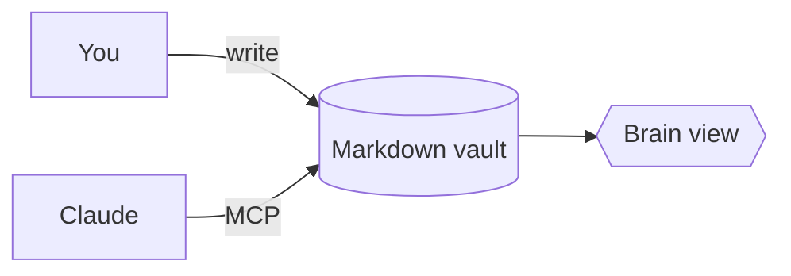

# Formatting Showcase

Everything Ultron can render. Switch to **Edit** (Ctrl/Cmd+E) to see the source.

## Text

**Bold**, *italic*, ~~strikethrough~~, `inline code`, ==highlight==, =={green}green highlight== and =={purple}purple==.
%%This comment is only visible in edit mode.%%

> A plain quote.

## Tasks

- [ ] Open task. Click the box in reading view to tick it.
- [x] Done task
- [-] Cancelled task
- [?] Question
- [!] Important
  - [ ] Nested task

## Callouts

> [!note] A note callout
> Callouts can contain **any** Markdown, even [[Ultron Mind|links]].

> [!tip]- Click to expand (foldable)
> Hidden until you open it.

> [!warning] Careful
> Something to watch out for.

## Links and embeds

- Link to a section: [[Ultron Mind#Decisions]]
- Link to a block: [[Formatting Showcase#^key-idea]]
- Hover over a link to preview the note.

This paragraph has a block id, so other notes can link straight to it. ^key-idea

An embedded section of another note:

![[Ultron Mind#Decisions]]

An image from the vault, resized to 96px:

![[ultron-logo.png|96]]

## Footnotes

Ultron stores notes as plain Markdown.[^1]

[^1]: So they work with git, Obsidian and any text editor.

## Math

Inline: $e^{i\pi} + 1 = 0$

$$
\int_0^1 x^2\,dx = \frac{1}{3}
$$

## Diagram



## Table

| Region | Holds |
| --- | --- |
| Frontal | Projects |
| Temporal | People |

## Code

```ts
const mind = await Vault.open('~/UltronMind');
```
